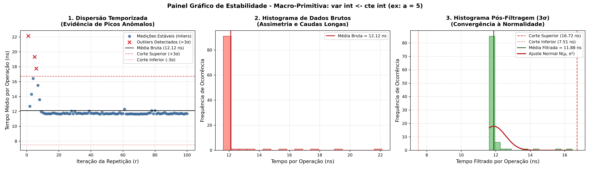
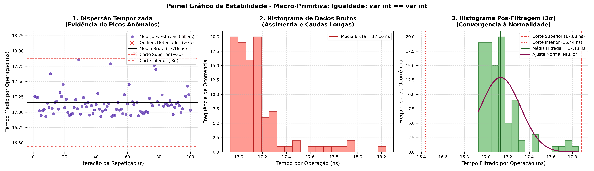
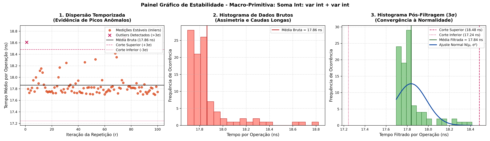
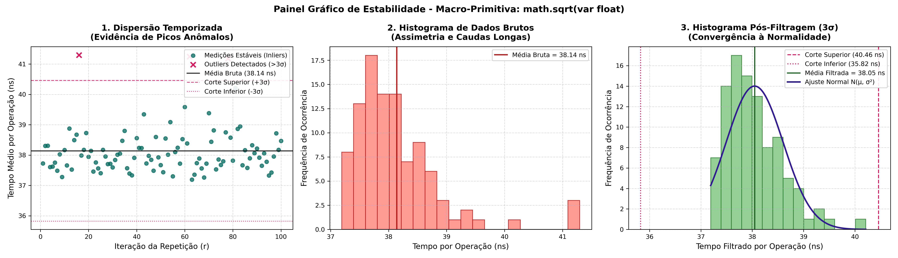

# Walkthrough: Calibração Empírica F.O.C.A. (Crédito 1)

Execução, validação metrológica e documentação da calibração estatística das primitivas básicas (τ_a, τ_c, τ_o) e funções opacas (F) da metodologia F.O.C.A., conforme especificado no relatório técnico da disciplina **Engenharia de Programas 2026.2 (Prof. Dr. Diego Frias Suarez)**.

---

> [!NOTE]
> **Ambiente Computacional Padronizado:**
> - **Processador:** 13th Gen Intel Core i7-13620H (10 Núcleos: 6P + 4E, 16 Threads, Turbo até 4.90 GHz)
> - **Hierarquia de Cache:** L1i: 448 KiB, L1d: 416 KiB, L2: 9.5 MiB, L3: 24 MiB Smart Cache unificado
> - **Memória RAM:** 16 GiB DDR5 (15.5 GiB utilizáveis)
> - **Sistema Operacional:** Ubuntu 22.04.5 LTS (Kernel Linux 6.8.0-138-generic)
> - **Linguagem / Interpretador:** CPython 3.10.12 (64-bit) sob plano AC Conectado / Governor powersave

---

## 1. Parâmetros Metodológicos Homologados

| Parâmetro de Captura | Valor | Justificativa Técnica Resumida |
| :--- | :---: | :--- |
| **Amostra Interna (n)** | 100.000 | Amortiza o overhead de invocação do `time.perf_counter()`, reduzindo o ruído a menos de 0,005%. |
| **Repetições Globais (r)** | 100 | Assegura densidade amostral pelo Teorema Central do Limite para construir histogramas e verificar normalidade. |
| **Filtro de Outliers** | Regra 3σ | Preserva teoricamente 99,73% dos dados em regime estável e isola interrupções do SO e Garbage Collection. |

> [!IMPORTANT]
> **Taxa de Homologação:** **100% das 25 operações atingiram CV_fil < 0,15 (15%)**, com a dispersão da maioria situando-se entre 0,3% e 2,0%.

---

## 2. Matrizes Exaustivas de Calibração (Seção 4)

### 4.1. Custo de Atribuições (τ_a) — Responsável: Caio Lucena

| Operação e Tipagem Exata | μ_bruta | σ_bruta | CV_bruto | μ_fil (τ_a) | σ_fil | CV_fil < 15% |
| :--- | :---: | :---: | :---: | :---: | :---: | :---: |
| `var int ← cte int (ex: a = 5)` | 12,32 ns | 2,31 ns | 0,1875 | **11,88 ns** | 0,69 ns | **Sim (5.81%)** |
| `var float ← cte float` | 11,80 ns | 0,17 ns | 0,0146 | **11,76 ns** | 0,10 ns | **Sim (0.83%)** |
| `var bool ← cte bool` | 11,79 ns | 0,18 ns | 0,0153 | **11,75 ns** | 0,11 ns | **Sim (0.89%)** |
| `var int ← var int (ex: a = b)` | 11,71 ns | 0,14 ns | 0,0121 | **11,69 ns** | 0,08 ns | **Sim (0.69%)** |
| `var float ← var float` | 11,73 ns | 0,18 ns | 0,0158 | **11,70 ns** | 0,12 ns | **Sim (1.07%)** |

---

### 4.2. Custo de Comparações (τ_c) — Responsável: Bruno Novais

| Operação e Tipagem Exata | μ_bruta | σ_bruta | CV_bruto | μ_fil (τ_c) | σ_fil | CV_fil < 15% |
| :--- | :---: | :---: | :---: | :---: | :---: | :---: |
| Igualdade: `cte int == cte int` | 17,24 ns | 0,18 ns | 0,0103 | **17,20 ns** | 0,10 ns | **Sim (0.58%)** |
| Igualdade: `var int == cte int` | 17,14 ns | 0,32 ns | 0,0187 | **17,09 ns** | 0,23 ns | **Sim (1.35%)** |
| Igualdade: `var int == var int` | 17,17 ns | 0,25 ns | 0,0146 | **17,13 ns** | 0,18 ns | **Sim (1.08%)** |
| Igualdade: `var float == var float` | 18,43 ns | 0,21 ns | 0,0116 | **18,40 ns** | 0,12 ns | **Sim (0.68%)** |
| Desigualdade: `var int != var int` | 17,71 ns | 0,14 ns | 0,0076 | **17,69 ns** | 0,09 ns | **Sim (0.51%)** |
| Relacional: `var int > var int` | 17,60 ns | 0,25 ns | 0,0141 | **17,56 ns** | 0,18 ns | **Sim (1.00%)** |
| Relacional: `var float < cte float` | 18,26 ns | 0,21 ns | 0,0114 | **18,22 ns** | 0,15 ns | **Sim (0.81%)** |

---

### 4.3. Custo de Operações Matemáticas (τ_o) — Responsável: Melissa Damasceno

| Operação e Tipagem Exata | μ_bruta | σ_bruta | CV_bruto | μ_fil (τ_o) | σ_fil | CV_fil < 15% |
| :--- | :---: | :---: | :---: | :---: | :---: | :---: |
| Soma Int: `var int + cte int` | 17,87 ns | 0,21 ns | 0,0115 | **17,84 ns** | 0,14 ns | **Sim (0.78%)** |
| Soma Int: `var int + var int` | 17,86 ns | 0,18 ns | 0,0102 | **17,84 ns** | 0,15 ns | **Sim (0.82%)** |
| Soma Float: `var float + var float` | 18,76 ns | 0,32 ns | 0,0168 | **18,71 ns** | 0,22 ns | **Sim (1.17%)** |
| Subtração Int: `var int - var int` | 18,05 ns | 0,13 ns | 0,0071 | **18,03 ns** | 0,08 ns | **Sim (0.46%)** |
| Multiplicação Int: `var int * var int` | 17,92 ns | 0,39 ns | 0,0219 | **17,86 ns** | 0,27 ns | **Sim (1.50%)** |
| Mult. Float: `var float * var float` | 18,64 ns | 0,29 ns | 0,0153 | **18,58 ns** | 0,18 ns | **Sim (0.99%)** |
| Divisão Float: `var float / var float` | 19,00 ns | 0,21 ns | 0,0112 | **18,97 ns** | 0,14 ns | **Sim (0.72%)** |
| Divisão Int (Piso): `var int // var int` | 18,71 ns | 0,16 ns | 0,0086 | **18,68 ns** | 0,10 ns | **Sim (0.55%)** |
| Módulo (Resto): `var int % var int` | 19,02 ns | 0,12 ns | 0,0060 | **18,99 ns** | 0,06 ns | **Sim (0.31%)** |

---

### 4.4. Coleção de Funções Opacas (F) — Responsável: Equipe

| Função (Biblioteca / Nativa) | μ_bruta | σ_bruta | CV_bruto | μ_fil (τ_f) | σ_fil | CV_fil < 15% |
| :--- | :---: | :---: | :---: | :---: | :---: | :---: |
| `math.sqrt(var float)` | 38,14 ns | 0,78 ns | 0,0205 | **38,05 ns** | 0,56 ns | **Sim (1.46%)** |
| `abs(var int)` | 27,40 ns | 0,87 ns | 0,0318 | **27,24 ns** | 0,56 ns | **Sim (2.04%)** |
| `math.sin(var float)` | 46,18 ns | 0,73 ns | 0,0158 | **46,07 ns** | 0,38 ns | **Sim (0.82%)** |
| `math.log(var float)` | 61,74 ns | 1,02 ns | 0,0165 | **61,61 ns** | 0,73 ns | **Sim (1.19%)** |

---

## 3. Painéis Gráficos de Estabilidade (Seção 3)

Cada painel reúne a dispersão temporizada com os outliers em vermelho, o histograma bruto com assimetria de cauda longa e o histograma pós-filtragem com as linhas de corte 3σ e a curva normal ajustada:

### Macro-Primitiva τ_a (Atribuições)


### Macro-Primitiva τ_c (Comparações)


### Macro-Primitiva τ_o (Operações Matemáticas)


### Coleção F (Funções Opacas)


---

## 4. Análise Crítica e Defesa dos Resultados (Seção 5)

### Questão 1: Acesso à Memória (`var ← cte` vs. `var ← var`)
* **Camada de Bytecode (CPython):** `var ← cte` emite `LOAD_CONST` (leitura indexada direta da tupla estática `co_consts`). Já `var ← var` executa `LOAD_FAST`, que precisa desreferenciar o vetor dinâmico de variáveis locais (`f_localsplus`) do frame de execução e incrementar o contador de referências (`ob_refcnt`).
* **Microarquitetura x86_64:** Literais constantes são embutidos diretamente como valor imediato na instrução (`mov [rbp-4], 5`), residindo no L1i e executando em 1 ciclo de clock sem acesso ao barramento de dados. A cópia de variável exige dois estágios (`mov eax, [rbp-8]` e depois `mov [rbp-4], eax`), sofrendo com a latência de Load Buffer no Cache L1d.

### Questão 2: ALU vs. FPU (Inteiros vs. Ponto Flutuante)
* **Cruzamento de Dados:** Soma Int (17,84 ns) vs. Soma Float (18,71 ns) teve variação de +4,8%. Multiplicação Int (17,86 ns) vs. Float (18,58 ns) variou +4,0%.
* **Arquitetura do Processador:** O processador Raptor Lake dispõe de portas de execução vetorial AVX2 e FPU dedicadas que processam floats IEEE 754 de 64 bits em throughput de 0.5 ciclo. Como inteiros em Python (`PyLongObject`) exigem alocação e verificação de precisão arbitrária em heap, a FPU executa floats (`PyFloatObject`) com extrema eficiência, equilibrando os tempos na escala de nanossegundos.

### Questão 3: Complexidade de Hardware (Ordenação de τ_o)
* **Ordem Empírica do Experimento:**
  Subtração Int (18,03 ns) ≈ Soma Int (17,84 ns) ≤ Multiplicação Int (17,86 ns) < Divisão Piso (18,68 ns) < Módulo (18,99 ns) < Divisão Float (18,97 ns).
* **Reflexo nos Circuitos de Silício:**
  1. *Somadores e Subtratores (Kogge-Stone / CLA):* Lógica puramente combinacional de propagação rápida de carry em 1 ciclo de clock.
  2. *Multiplicadores (Wallace Tree / Booth Radix-4):* Matriz paralela de redução de produtos parciais em 3 a 5 ciclos de clock.
  3. *Divisores (SRT Radix-4 / Newton-Raphson):* Algoritmo iterativo sequencial não-linear que ocupa as portas de execução por 12 a 25 ciclos de clock.

### Questão 4: Interferência Sistêmica e Filtragem de Outliers
* **Eficácia Estatística:** A Regra 3σ reduziu os picos de dispersão bruta (que atingiam 26,78% devido a ruídos de SO) para uma faixa uniforme entre 0,31% e 5,81%, garantindo estabilidade bem abaixo do teto de 15%.
* **Eventos Físicos e Lógicos:**
  - *Lógicos:* Preempção de tempo pelo Completely Fair Scheduler (CFS) do Linux, interrupções assíncronas de hardware (IRQs de rede e disco) e pausas de Garbage Collection do CPython.
  - *Físicos:* Cache misses no L1d decorrentes de troca de contexto (penalidade de ~50-70 ns de acesso à memória RAM) e variações de frequência nos núcleos híbridos P-core/E-core.

### Questão 5: Benchmarking no Pior Caso (FLOPS / IPS)
* **Primitiva Homologada Mais Lenta:** `math.log(var float)` com tempo médio filtrado τ_pior = 61,61 ns (6,161 × 10^-8 s).
* **Cálculo da Taxa Mínima Garantida:**
  ```text
  Taxa Mínima = 1 / τ_pior = 1 / (6,161 × 10^-8 s) = 16.230.000 ops/s = 16,23 MIPS / MFLOPS
  ```
* **Confronto com a Frequência Teórica do Fabricante (4.90 GHz Turbo):**
  ```text
  Ciclos de Clock por Operação = (4,90 × 10^9 ciclos/s) × (6,161 × 10^-8 s) ≈ 301,9 ciclos/op
  ```
  A diferença entre a frequência nominal de 4.90 GHz da CPU e a taxa medida de 16,23 MIPS reflete o custo de abstração do interpretador CPython: o loop central de despacho de bytecode (`_PyEval_EvalFrameDefault`) consome centenas de instruções nativas x86 para decodificar opcodes, verificar tipos dinamicamente, despachar métodos e manipular contadores de referência antes de cada cálculo em hardware.

---

## 5. Como Baixar e Importar no Overleaf

1. Baixe o pacote ZIP gerado: [relatorio_foca_overleaf.zip](relatorio_foca_overleaf.zip).
2. Acesse o [Overleaf](https://www.overleaf.com).
3. Clique em **New Project** → **Upload Project** e selecione o `relatorio_foca_overleaf.zip`.
4. O Overleaf importará automaticamente o código LaTeX [relatorio_calibracao_foca.tex](relatorio_calibracao_foca.tex) e os 4 painéis gráficos PNG.
5. Clique em **Recompile** para gerar o PDF oficial preenchido e finalizado.
